# InternHub

**Learn. Intern. Build Your Future.**

InternHub is a full-stack internship platform for college students. Explore career domains, apply to structured programs, complete payment, track progress, and receive offer letters plus QR-verifiable certificates — from one product.

This repository is a production-style EdTech application with separate **student** and **admin** experiences, a pricing engine, JWT sessions, and CMS-managed content. It is designed to feel like a real career product, not a class demo.

<p align="center">
  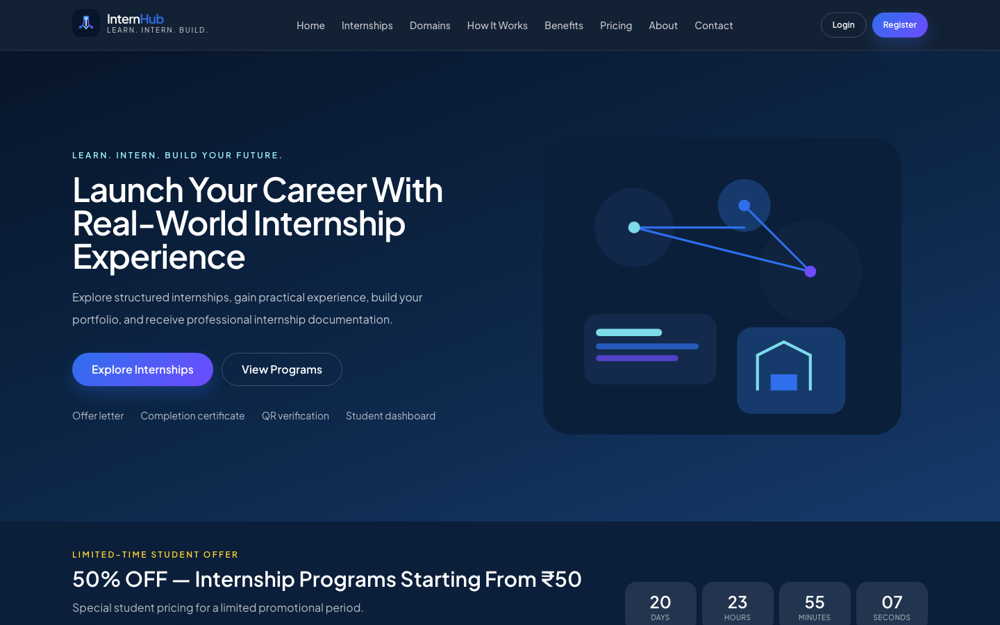
</p>

<p align="center">
  
  
  
  
  
  
</p>

<p align="center">
  <a href="https://github.com/rjyothiprakash2003/InternHub">github.com/rjyothiprakash2003/InternHub</a>
</p>

---

## Table of contents

1. [What InternHub does](#what-internhub-does)
2. [Screenshots](#screenshots)
3. [Tech stack](#tech-stack)
4. [Architecture](#architecture)
5. [Prerequisites](#prerequisites)
6. [Step-by-step setup](#step-by-step-setup)
7. [Demo accounts](#demo-accounts)
8. [Walkthrough: student journey](#walkthrough-student-journey)
9. [Walkthrough: admin operations](#walkthrough-admin-operations)
10. [Pricing engine](#pricing-engine)
11. [Payments](#payments)
12. [Environment variables](#environment-variables)
13. [Available scripts](#available-scripts)
14. [Project structure](#project-structure)
15. [Testing](#testing)
16. [Production notes](#production-notes)
17. [Author](#author)

---

## What InternHub does

Students can:

- Browse internship domains and programs
- Register and log in from a single auth page
- Complete a profile with a completion score
- Apply using **approved domain and duration dropdowns only**
- See original price, discount, and payable amount before checkout
- Complete demo checkout (Razorpay-ready architecture)
- Track application status from applied → certificate
- View offer letters, certificates, invoices, and notifications
- Verify certificates publicly at `/verify/certificate/{id}`

Administrators can:

- Manage students, domains, internships, applications, payments, discounts, FAQs, testimonials, and homepage content
- Update pricing without changing source code
- Generate offer letters and certificates from database records
- Revoke certificates
- View analytics and audit logs
- Enable AICTE / ISO placeholder branding only after authorization exists

InternHub does **not** claim AICTE approval, ISO certification, government approval, university affiliation, placements, or partnerships unless an administrator enables verified content.

---

## Screenshots

### Public website

| Homepage | Internship catalog |
| --- | --- |
|  | 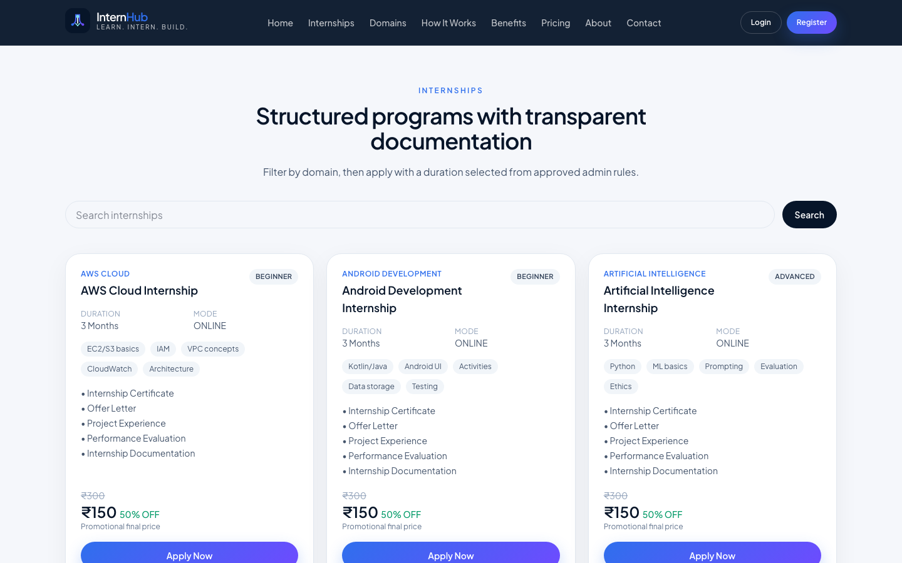 |

| Career domains | Student pricing |
| --- | --- |
| 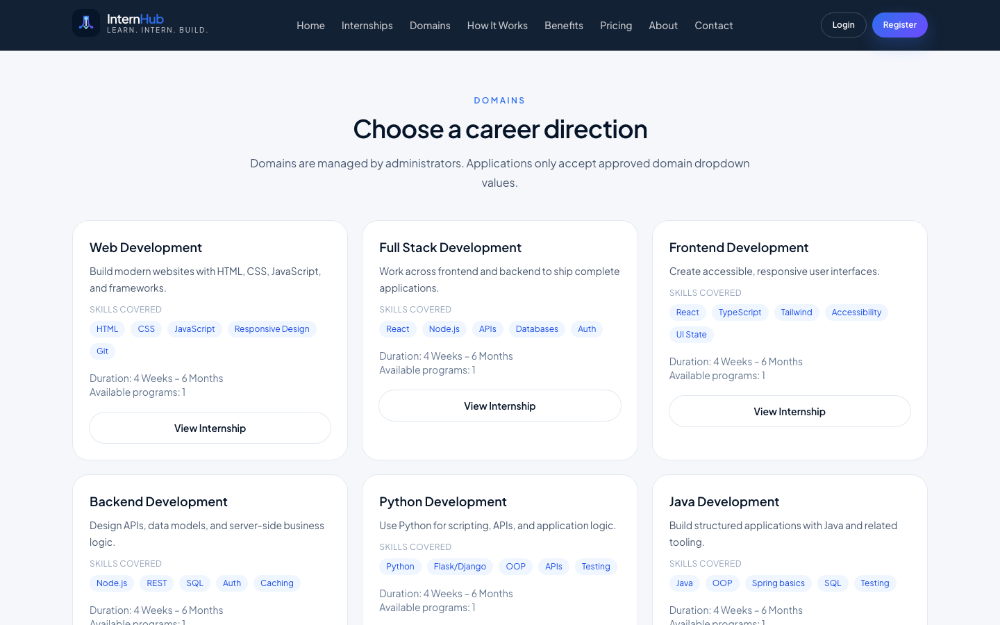 |  |

### Student and admin

| Login | Student dashboard |
| --- | --- |
| 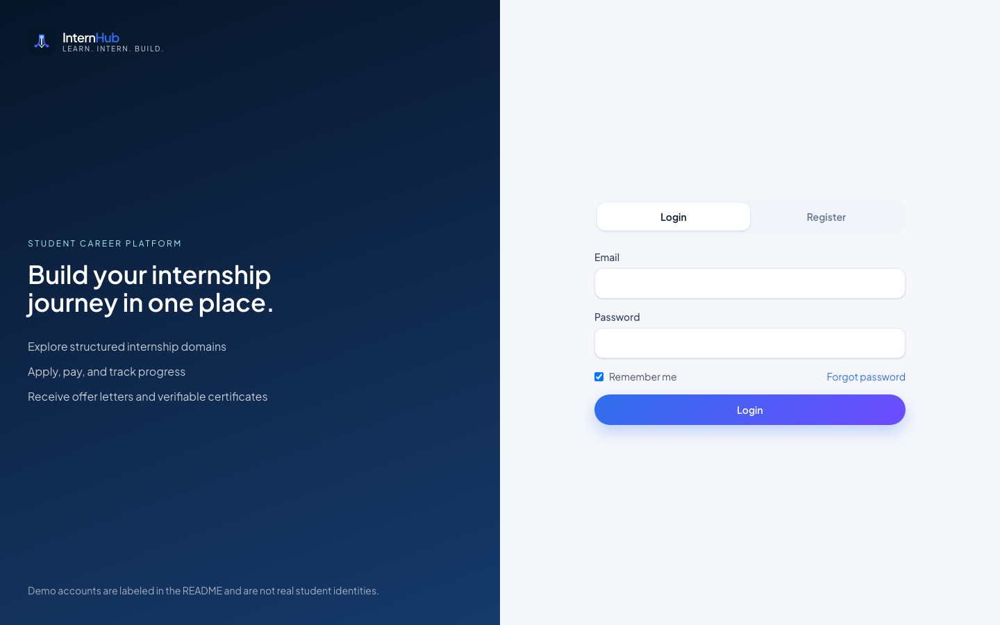 | 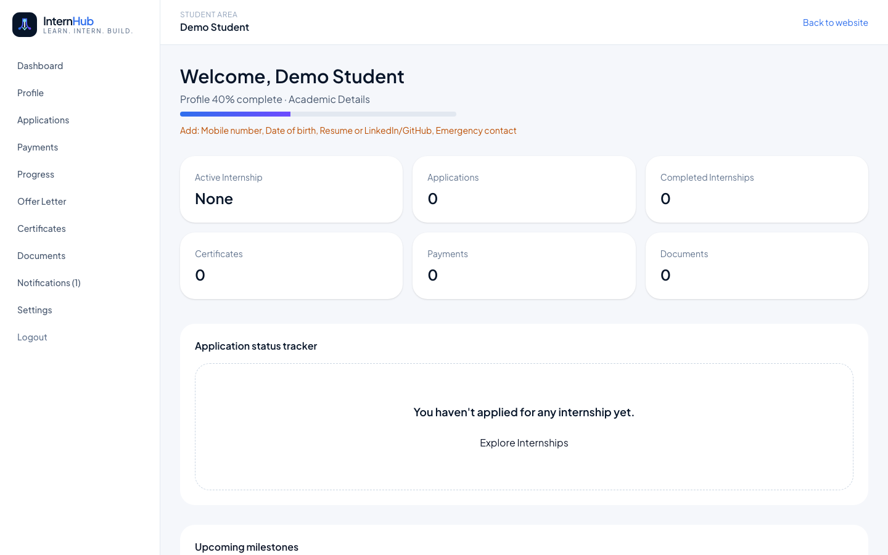 |

| Application form | Admin operations |
| --- | --- |
| 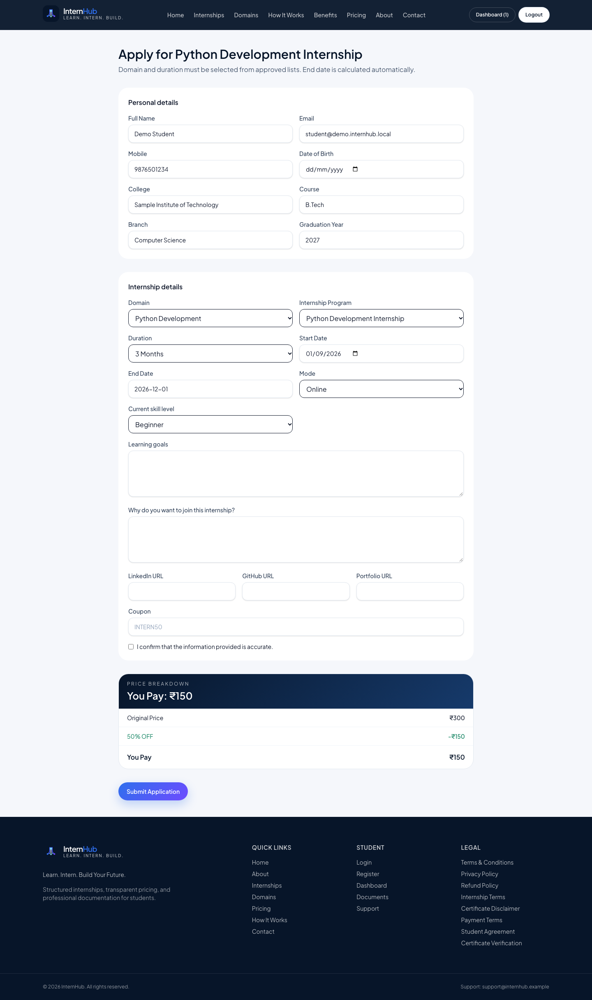 | 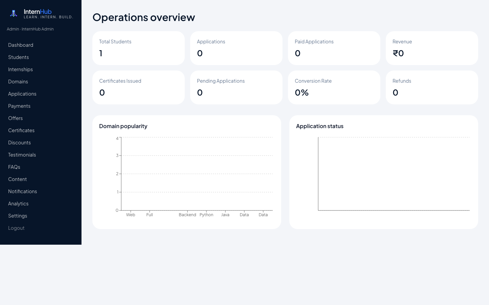 |

---

## Tech stack

| Layer | Choice |
| --- | --- |
| Framework | Next.js 16 (App Router) + React 19 |
| Language | TypeScript |
| Styling | Tailwind CSS 4 |
| Database | Prisma + SQLite locally (PostgreSQL-ready) |
| Auth | JWT in an httpOnly cookie (`internhub_session`) |
| Validation | Zod |
| Payments | Demo mode now, Razorpay-ready later |
| Email | Resend-ready templates |
| Charts | Recharts |
| Documents | Offer letters, certificates, QR verification |

---

## Architecture

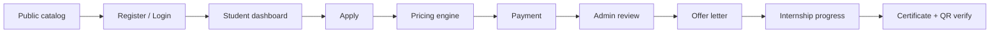

Protected routes:

| Path | Who can access |
| --- | --- |
| `/dashboard/*` | Signed-in students |
| `/apply/*` | Signed-in students |
| `/admin/*` | Signed-in administrators |
| `/verify/*` | Public |

---

## Prerequisites

Install these before you start:

| Tool | Version | Check |
| --- | --- | --- |
| Node.js | 20 or newer | `node -v` |
| pnpm | 11 (this repo pins `pnpm@11.22.0`) | `pnpm -v` |
| Git | Any current version | `git --version` |

If pnpm is missing:

```bash
npm install -g pnpm
```

---

## Step-by-step setup

Follow these steps in order on your machine.

### Step 1 — Clone the repository

```bash
git clone https://github.com/rjyothiprakash2003/InternHub.git
cd InternHub
```

### Step 2 — Install dependencies

```bash
pnpm install
```

This also runs `prisma generate` via the `postinstall` script.

### Step 3 — Create the environment file

```bash
cp .env.example .env
```

Open `.env` and set at least:

```bash
DATABASE_URL="file:./dev.db"
AUTH_SECRET="replace-with-a-long-random-secret"
NEXT_PUBLIC_APP_URL="http://localhost:3000"
PAYMENT_MODE="demo"
```

Generate a secret:

```bash
openssl rand -hex 32
```

Paste the output into `AUTH_SECRET`. Do not commit `.env`.

### Step 4 — Create and seed the database

```bash
pnpm db:push
pnpm db:seed
```

`db:push` syncs `prisma/schema.prisma` to SQLite.  
`db:seed` loads domains, internships, pricing, FAQs, testimonials, and demo users.

To wipe local data and seed again:

```bash
pnpm db:reset
```

Use `db:reset` only on a local development database.

### Step 5 — Start the development server

```bash
pnpm dev
```

Open [http://localhost:3000](http://localhost:3000).

You should see the homepage:

<p align="center">
  
</p>

### Step 6 — Optional checks

```bash
pnpm test
pnpm lint
pnpm build
```

---

## Demo accounts

These accounts are **seeded demo data**. They are not real people.

| Role | Email | Password | Lands on |
| --- | --- | --- | --- |
| Student | `student@demo.internhub.local` | `DemoStudent@2026` | `/dashboard` |
| Admin | `admin@demo.internhub.local` | `DemoAdmin@2026` | `/admin` |

---

## Walkthrough: student journey

### 1. Create an account

Go to [http://localhost:3000/login](http://localhost:3000/login).

<p align="center">
  
</p>

Use the demo student account, or open the **Register** tab and create your own student.

<p align="center">
  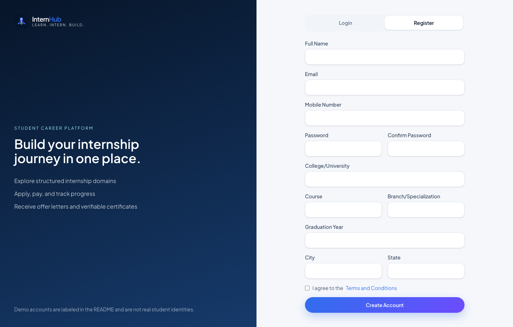
</p>

Registration requires:

- Full name, email, 10-digit Indian mobile number
- Password (minimum 8 characters) and confirmation
- College, course, branch, graduation year
- City, state
- Acceptance of Terms and Conditions

### 2. Choose a domain and internship

Open **Internships** or **Domains**.

<p align="center">
  
</p>

Each program card shows duration, mode, skills, documentation included, and the promotional price.

<p align="center">
  
</p>

Open a domain such as `/internships/python-development` for the program detail.

<p align="center">
  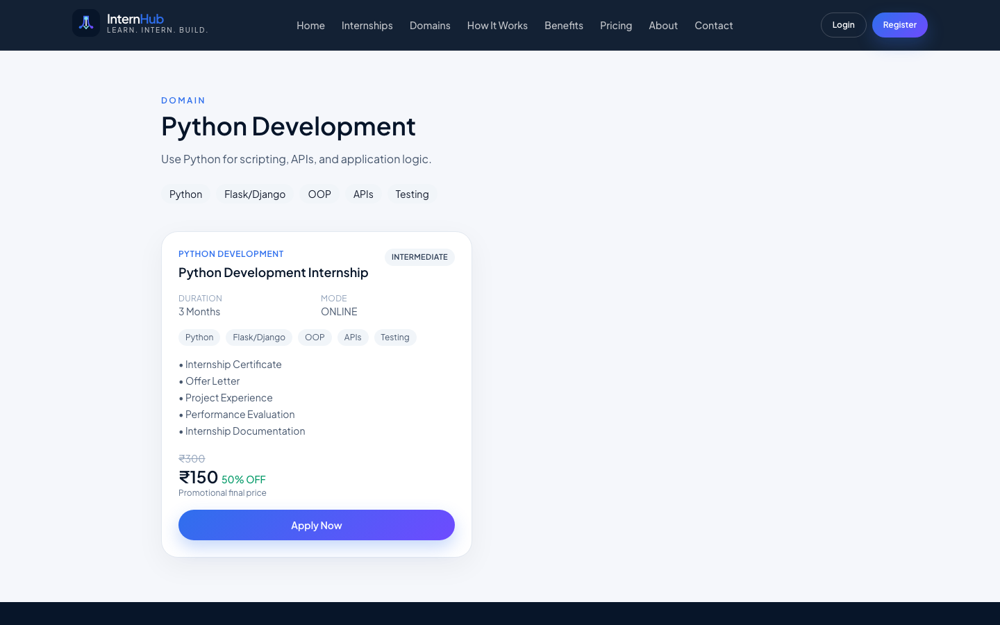
</p>

### 3. Review how it works and pricing

The public **How It Works** page is the six-step path from account creation to certificate.

<p align="center">
  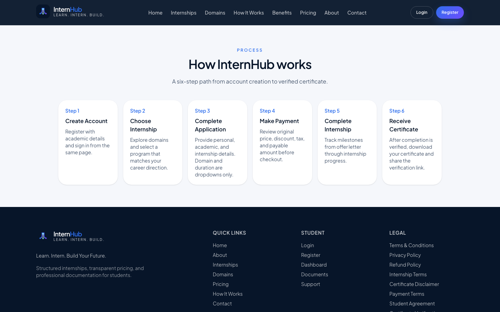
</p>

Pricing is loaded from the admin pricing engine. Cards show the **promotional / final** amount.

<p align="center">
  
</p>

Example for **3 Months**:

| Line | Amount |
| --- | --- |
| Original price | ₹300 |
| 50% OFF | −₹150 |
| You pay | **₹150** |

The UI never hard-codes those numbers. They come from `PricingPlan` records.

### 4. Complete your profile

After login you land on the student dashboard.

<p align="center">
  
</p>

Open **Profile** and add the missing fields. The completion bar updates as you save.

<p align="center">
  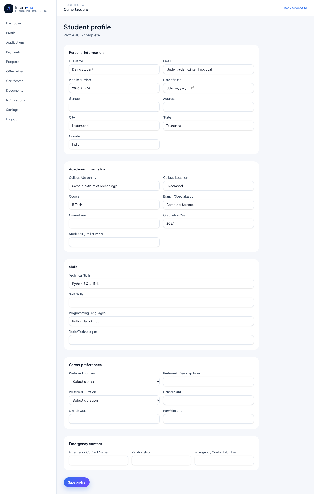
</p>

### 5. Apply

Click **Apply Now** on a program (example: Python Development). You must be signed in as a student.

<p align="center">
  
</p>

Important rules:

- Domain and duration are **dropdowns from admin-approved lists**
- End date is calculated from the start date and duration rule
- Price breakdown updates when duration or a coupon changes
- Try coupon `INTERN50` in demo data
- Confirm the information is accurate before submit

### 6. Pay, track, and collect documents

After submit, use:

| Page | Purpose |
| --- | --- |
| `/dashboard/applications` | Application list and status |
| `/dashboard/payments` | Invoices and payment status |
| `/dashboard/payment/[id]` | Demo checkout |
| `/dashboard/offer-letter` | Generated offer letter |
| `/dashboard/progress` | Internship milestones |
| `/dashboard/certificates` | Completion certificate |
| `/dashboard/documents` | Uploaded and generated files |
| `/dashboard/notifications` | In-app alerts |

<p align="center">
  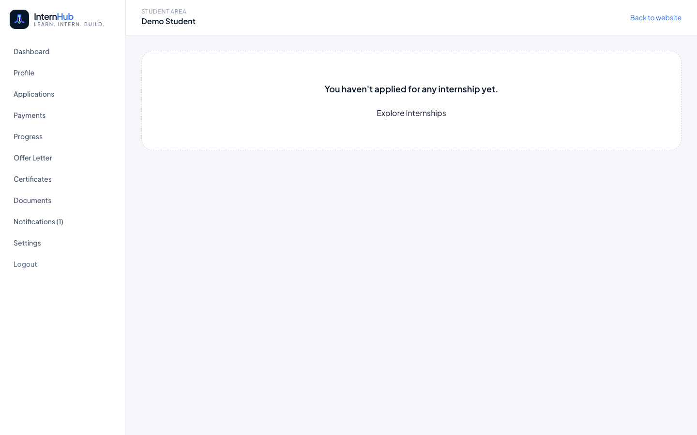
</p>

### 7. Verify a certificate

Anyone can verify a document without logging in.

Open [http://localhost:3000/verify/certificate](http://localhost:3000/verify/certificate) and enter a certificate ID such as `INH-CERT-2026-000001`.

<p align="center">
  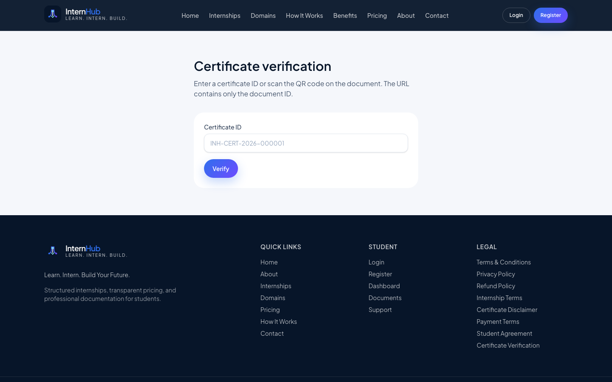
</p>

The verification URL contains only the document ID. Results can be valid, revoked, or not found.

---

## Walkthrough: admin operations

Sign in with the admin demo account. Students cannot open `/admin`; they are sent to `/403`.

<p align="center">
  
</p>

### Internships and pricing

**Internships** lists every program, domain, level, and active flag.

<p align="center">
  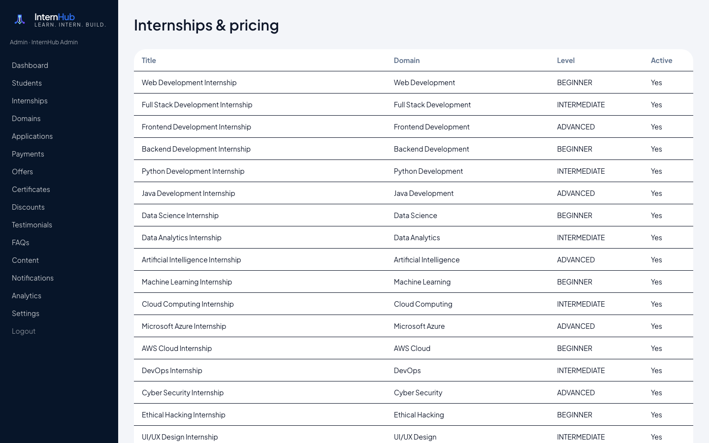
</p>

### Applications

Review submitted applications, move status, and generate offer letters or certificates from verified records.

<p align="center">
  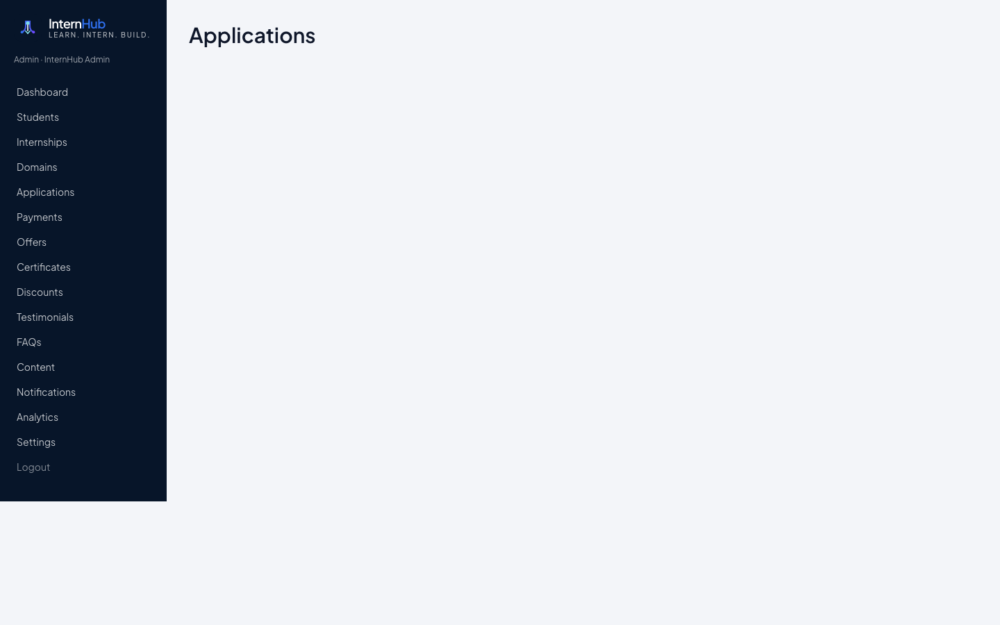
</p>

### Discounts

Create coupon codes such as `INTERN50` without changing UI code.

<p align="center">
  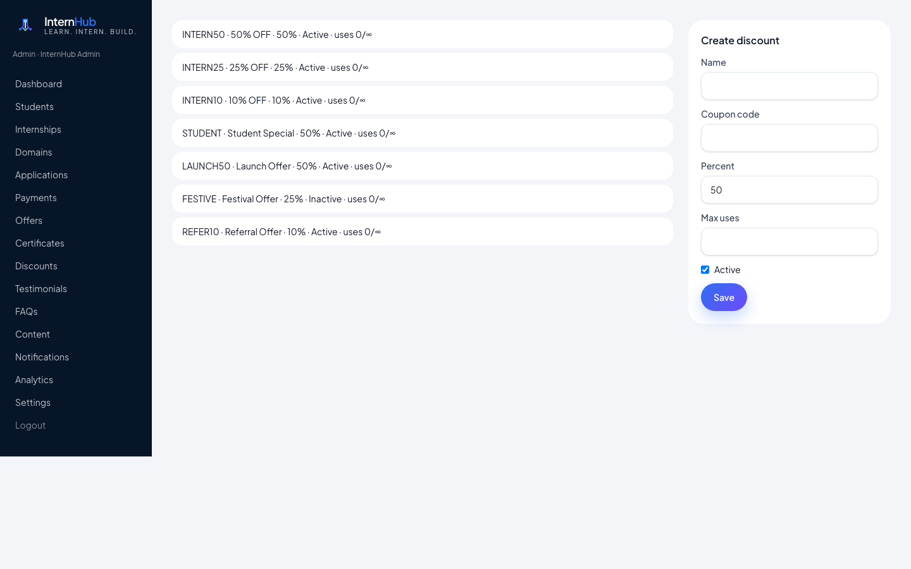
</p>

### Settings and CMS

Use **Settings**, **Content**, **FAQs**, and **Testimonials** to edit homepage copy, promo countdown, support email, and branding flags.

<p align="center">
  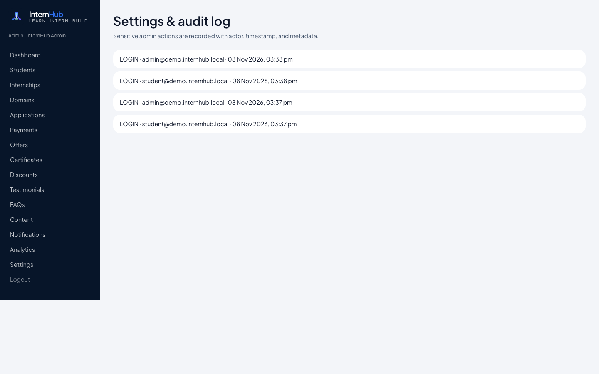
</p>

Admin sidebar:

Dashboard · Students · Internships · Domains · Applications · Payments · Offers · Certificates · Discounts · Testimonials · FAQs · Content · Notifications · Analytics · Settings

---

## Pricing engine

Canonical calculation lives in `lib/pricing.ts`.

Rules:

1. `originalPrice` is the list price
2. If a promotional price is set and no extra coupon is applied, the promotional price **is** the payable amount
3. A coupon can replace the promotional discount (`INTERN50`, `INTERN25`, and others in seed data)
4. Tax is optional and controlled from admin settings

Default seeded catalog (50% student offer):

| Duration | Original | You pay |
| --- | --- | --- |
| 4 Weeks | ₹100 | ₹50 |
| 6 Weeks | ₹150 | ₹75 |
| 2 Months | ₹200 | ₹100 |
| 3 Months | ₹300 | ₹150 |
| 4 Months | ₹400 | ₹200 |
| 5 Months | ₹500 | ₹250 |
| 6 Months | ₹600 | ₹300 |

---

## Payments

`PAYMENT_MODE=demo` completes checkout through a **server action**. Card numbers are never stored.

To connect Razorpay later:

```bash
PAYMENT_MODE=razorpay
RAZORPAY_KEY_ID=your_key_id
RAZORPAY_KEY_SECRET=your_key_secret
```

Always verify the payment on the server before marking an application paid. The create / verify routes already exist under `app/api/payments/`.

---

## Environment variables

Copy from `.env.example`:

| Variable | Required locally | Purpose |
| --- | --- | --- |
| `DATABASE_URL` | Yes | SQLite file or PostgreSQL URL |
| `AUTH_SECRET` | Yes | Signs JWT session cookies |
| `NEXT_PUBLIC_APP_URL` | Yes | Canonical site URL |
| `PAYMENT_MODE` | Yes | `demo` or `razorpay` |
| `RAZORPAY_KEY_ID` | Razorpay only | Public Razorpay key |
| `RAZORPAY_KEY_SECRET` | Razorpay only | Server Razorpay secret |
| `RESEND_API_KEY` | Optional | Transactional email |
| `EMAIL_FROM` | Optional | From address for email |
| `S3_ACCESS_KEY` / `S3_SECRET_KEY` / `S3_BUCKET` / `S3_REGION` | Optional | Object storage |
| `SENTRY_DSN` | Optional | Error reporting |

---

## Available scripts

```bash
pnpm dev          # Start Next.js locally
pnpm build        # Generate Prisma client and production build
pnpm start        # Run the production server
pnpm lint         # ESLint
pnpm test         # Pricing and duration checks
pnpm db:generate  # prisma generate
pnpm db:push      # Sync schema to the database
pnpm db:seed      # Load demo catalog and users
pnpm db:reset     # Wipe local DB, then seed
```

---

## Project structure

```text
internhub/
├── app/
│   ├── page.tsx                 # Homepage
│   ├── internships/             # Catalog and domain detail
│   ├── apply/                   # Student application
│   ├── login/                   # Login + register
│   ├── dashboard/               # Student area
│   ├── admin/                   # Admin operations
│   ├── verify/                  # Public certificate / offer lookup
│   ├── api/                     # Auth, payments, internships, documents
│   └── legal/                   # Terms, privacy, refunds, and related pages
├── components/                  # Layout, catalog cards, forms, UI
├── lib/                         # Auth, pricing, payments, validation, DB
├── prisma/
│   ├── schema.prisma            # Data model
│   └── seed.ts                  # Demo catalog and users
├── docs/screenshots/            # README product screenshots
├── tests/                       # Pricing and duration tests
└── .env.example                 # Environment template
```

Useful public routes:

| Route | Page |
| --- | --- |
| `/` | Home |
| `/internships` | Programs |
| `/domains` | Career domains |
| `/how-it-works` | Six-step process |
| `/benefits` | Student benefits |
| `/pricing` | Duration pricing |
| `/about` | About InternHub |
| `/faq` | Frequently asked questions |
| `/contact` | Support form |
| `/login` | Login |
| `/login?tab=register` | Register |
| `/verify/certificate` | Certificate lookup |

---

## Testing

```bash
pnpm test
```

This runs `tests/pricing-duration.test.ts` and checks:

- 50% of ₹300 is ₹150 payable
- Promotional price implies the same discount
- A 6-week internship starting 1 Sep 2026 ends on 13 Oct 2026

---

## Production notes

- Switch Prisma `provider` to `postgresql` and point `DATABASE_URL` at Neon, Supabase, or another Postgres host
- Store uploads in S3 or R2 instead of local disk (`uploads/` is gitignored)
- Enable Resend for transactional email
- Set a long random `AUTH_SECRET` and never reuse the example value
- Keep one InternHub logo component everywhere: navbar, footer, dashboards, documents, and emails
- Leave AICTE / ISO badges off until real authorization exists

---

## More product pages

| FAQ | Contact | About |
| --- | --- | --- |
| 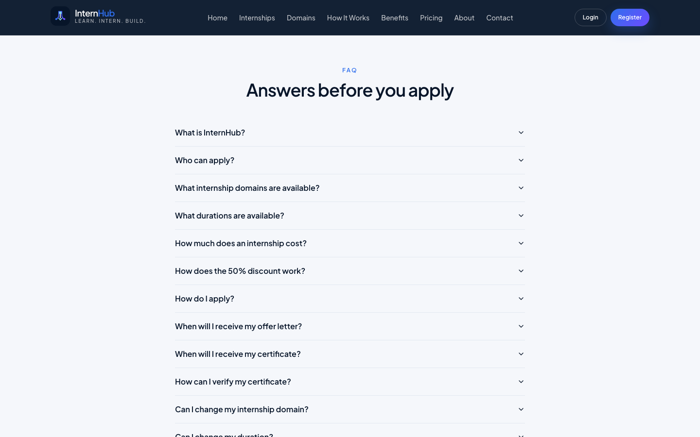 | 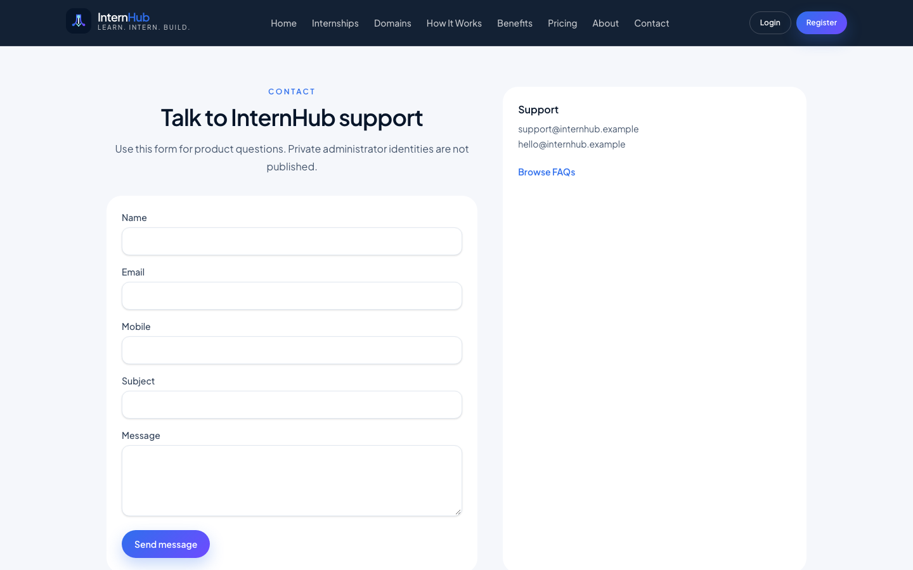 | 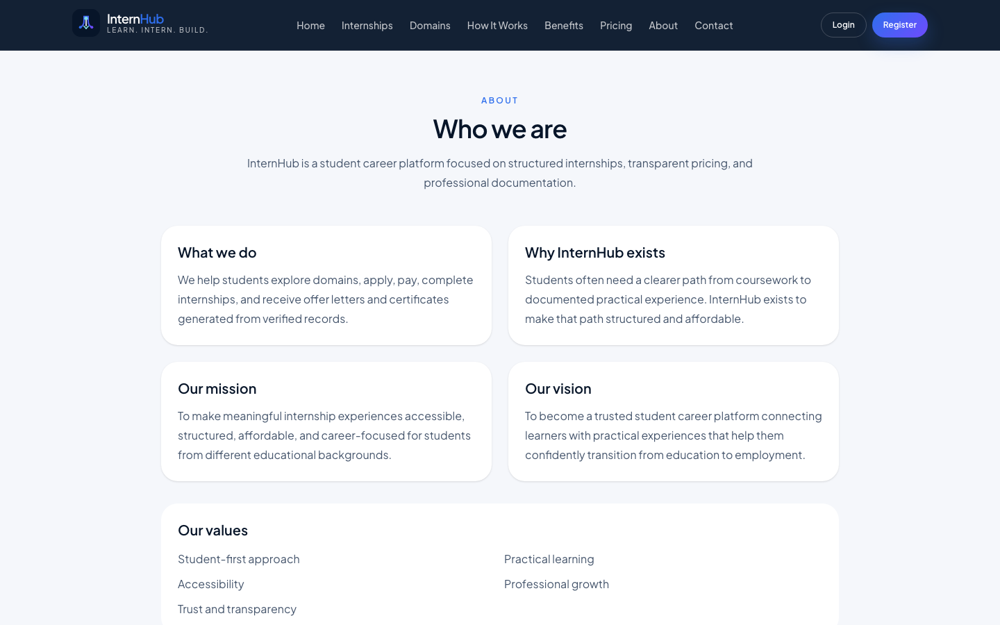 |

<p align="center">
  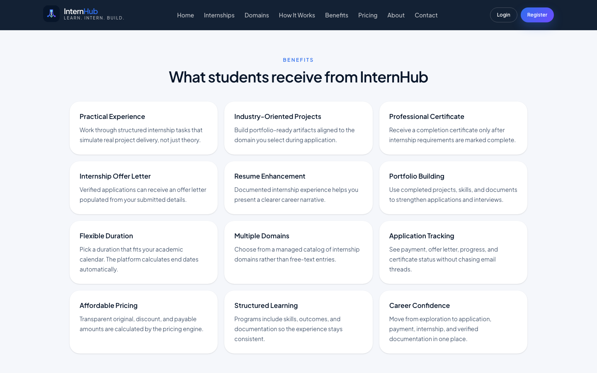
</p>

---

## Author

**R Jyothi Prakash**

- GitHub: [@rjyothiprakash2003](https://github.com/rjyothiprakash2003)
- Repository: [github.com/rjyothiprakash2003/InternHub](https://github.com/rjyothiprakash2003/InternHub)

Built as a complete internship platform: catalog, applications, payments, admin CMS, and verifiable documents.

---

## License

Private project source unless otherwise stated by the author. Demo accounts, sample testimonials, and screenshots are labeled example data and are not real student identities or employer claims.
